I’m Trí, a developer from Vietnam. I’m the founder of [Gióng](https://giong.run), an async runtime for Rust, and the CTO of [GreenZone.ai](https://www.thegreenzone.ai), an AI company in Australia.

### Gióng

[](https://giong.run)

In Vietnamese legend, Thánh Gióng lay silent for three years, then rose a giant the day his country called. The runtime carries his name because it does the same: it costs next to nothing while idle and uses every core the moment load arrives.

Gióng is a thread-per-core async runtime for Rust services. It is built on io_uring on Linux, falls back to epoll wherever io_uring is blocked, and runs every crate on macOS (kqueue) and Windows (I/O completion ports) too. It brings its own HTTP/1.1, HTTP/2 and HTTP/3 server and client, TLS, gRPC, QUIC, PostgreSQL, MySQL and Redis clients, a web framework and an MCP server, so a whole service runs on it with no Tokio underneath.

- **About 0.03 system calls per request.** A server built on epoll needs 2.
- **Measured against the Tokio crates it replaces**, one core each: HTTPS at 146.6k requests/s against 81.2k for Axum, PostgreSQL at 3.3 times tokio-postgres with a pool, MySQL at 5.1 times SQLx.
- **A developer kit in one command.** `giong new` writes a service that builds, passes its tests and serves from the first minute, on SQLite by default, so there is nothing to install or start. `giong dev` rebuilds on every save and swaps the new build in without dropping a request: 0 failed out of 102,061 over 100 reloads under load. `giong upgrade`, `giong doctor`, `giong ai init`, a dashboard, OpenAPI and request recording cover the rest.
- **Made for the agents that write your code.** Every error has a stable code, the cause and the fix, and `giong mcp` hands the whole kit to your coding agent as tools.

```sh
curl -fsSL https://giong.run/install.sh | sh    # or: cargo install giong-cli --locked
giong new api
cd api && giong dev
```

```rust
use giong::net::TcpListener;
use giong_http::{Request, Response, Server};

async fn handler(req: Request) -> Response {
    match (req.method(), req.path()) {
        ("GET", "/health") => Response::text("ok"),
        ("POST", "/echo") => Response::new(200).body(req.body().to_vec()),
        _ => Response::new(404),
    }
}

fn main() -> std::io::Result<()> {
    giong::Builder::new()
        .shutdown_on_signals(true)
        .build()?
        .run(|_worker| async {
            // One listener per core on the same port; the kernel spreads the connections.
            let listener = TcpListener::bind("0.0.0.0:8080").expect("bind");
            Server::new().serve(listener, handler).await;
        })
}
```

Gióng 1.5.3 is the current release. The API has been frozen since 1.0, and every 1.x release only adds: 1.1 brought gRPC, 1.2 macOS, 1.3 HTTP/3 and QUIC, 1.4 Windows, 1.5 the developer kit and every crate on Windows, 1.5.1 SQLite projects, `giong upgrade` and Unix sockets on Windows, 1.5.2 leaner connections (an idle TLS connection holds 5.2 KiB instead of 10.8), and 1.5.3 leaner HTTP/2 (an idle HTTP/2 connection over TLS holds 6.2 KiB instead of 9.5) and release binaries with signed build provenance and an SBOM. Each number above has its method and raw data [in the repository](https://github.com/giong-run/Giong#benchmarks), next to the cases where Gióng is not ahead.

[giong.run ↗](https://giong.run) · [Source ↗](https://github.com/giong-run/Giong) · [Release 1.5.3 ↗](https://github.com/giong-run/Giong/releases/tag/v1.5.3) · [crates.io ↗](https://crates.io/crates/giong) · [Roadmap ↗](https://giong.run/roadmap/)

### Apps and small worlds

One of my browser games has a tram that crosses town while the players take their turns. The tram has nothing to do with the dice. I just wanted the place to feel lived in.

I build mobile apps, the APIs behind them, and the tools people use to run them. On a map, a pin takes one tap to open. Behind that tap there’s a database, an API, and a moderation screen where someone can correct the place you’re looking at. I like working on all three.

### What I want to leave here

I want to share more of the things I wish I’d found when I started: a small tool you can take apart, an example you can actually run, or the search result I needed three hours into debugging.

[Explore my public work ↗](https://github.com/thekivashyn?tab=repositories&q=&type=public&language=&sort=)

Built something with my code? Tag me on X [@tringuyenvnn](https://x.com/tringuyenvnn). I’d love to see what you made.
