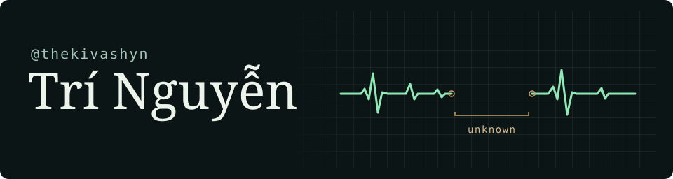

I’m Trí, a developer in Vietnam. A question I like working on is what an app can still know after a connection drops. That question made its way into my Rust event engine.

### tiktok-live-rust

An unofficial engine for reading TikTok LIVE events. A chat message comes out as one line of JSON. If the connection drops halfway through a gift combo, the engine can report the missing count as `null`. The app on the other end gets to know where the gap is.

[Explore the source](https://github.com/thekivashyn/tiktok-live-rust) · [Run the offline demo](https://github.com/thekivashyn/tiktok-live-rust#try-it-without-a-live-room)

### Gửi người đến sau

Mình muốn chia sẻ nhiều hơn những thứ từng khiến mình ngồi gỡ hàng giờ. Có khi chỉ là một đoạn code nhỏ, một ví dụ chạy được, hay vài dòng ghi lại vì sao một cách làm bị hỏng. Nếu nó giúp bạn bớt một buổi mò mẫm, mình có lý do để viết tiếp.

Nếu bạn dùng thử engine và gặp một event lạ, mình muốn xem ví dụ nhỏ nhất tái hiện được nó. [Mở issue ở đây ↗](https://github.com/thekivashyn/tiktok-live-rust/issues)
